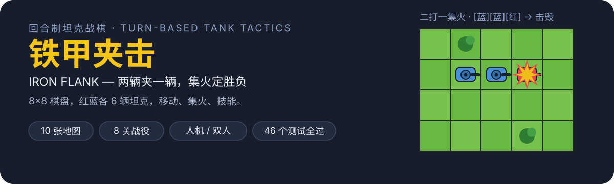
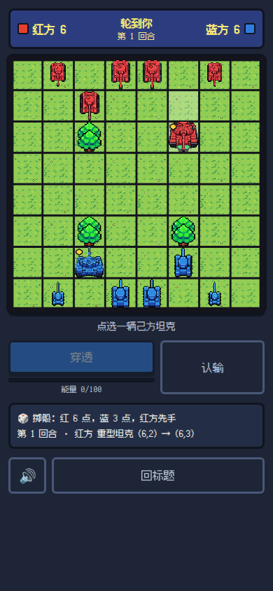
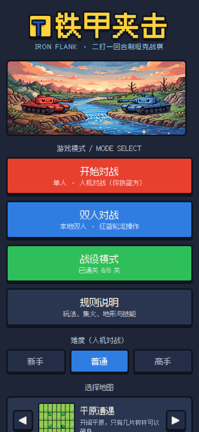

<p align="right"><a href="README.md">中文</a></p>

<p align="center">
  
</p>

<p align="center">
  <a href="https://holynova.github.io/iron-flank/">▶ Play Online</a>
  ·
  <a href="https://github.com/holynova/iron-flank">GitHub Repository</a>
</p>

Iron Flank is a turn-based tank tactics game built around a "two-on-one" focus-fire rule: on an 8×8 board, Red and Blue each command 6 tanks and move in turns; when two of your tanks line up with one enemy tank, the enemy is destroyed by focus fire. Reduce the enemy to a single tank to win. Mobile-first and playable in portrait mode, zero build, pure JavaScript + Canvas.

## Screenshots

<p align="center">
  
  
</p>

## How to Play

- **Move**: move one tank per turn, 1 square orthogonally; light tanks may move 2 squares (and may stop after the first step). Mountains and rivers are impassable.
- **Two-on-one focus fire**: after a tank lands, its row and column are scanned. Three consecutive squares reading `[me][me][foe]` or `[foe][me][me]` destroy the outermost enemy. Rows and columns resolve independently, so one move can destroy at most two tanks.
  - **Friendly cover**: focus fire fails when the target is adjacent to a friendly tank of the same color.
  - **Crowded exemption**: a line with more than 4 tanks does not resolve at all.
  - **Terrain immunity**: tanks on forest or city tiles are immune to focus fire.
  - **Heavy tanks**: the first focus fire only strips their armor; the second destroys them.
- **Commander skills**: every kill grants +50 energy; at 100 you can unleash a skill, lasting until the start of your next turn.
  - Red's 「铁壁」 ("Iron Wall"): your whole army becomes immune to focus fire.
  - Blue's 「穿透」 ("Pierce"): your focus fire ignores friendly cover.
- **Winning**: reduce the enemy to ≤1 tank; if 100 turns pass undecided, the winner is decided by remaining tanks and kill count; if neither side can move, it's a draw. A dice roll decides who moves first.

## Modes & Content

- **Vs AI**: three difficulties (新手 Beginner / 普通 Normal / 高手 Expert) with a heuristic AI; you play Blue.
- **Local 2-player**: take turns on the same device.
- **Campaign**: 8 levels of increasing difficulty (简单 Easy ×2, 普通 Normal ×3, 困难 Hard ×3); winning unlocks the next level.
- **10 maps**: 平原遭遇 (Plain Encounter), 森林夹击 (Forest Pincer), 断河防线 (Broken River Defense), 群山隘口 (Mountain Pass), 双城对峙 (Twin Cities Standoff), 混合战场 (Mixed Battlefield), 纵贯河道 (River Traverse), 城市巷战 (Urban Street Battle), 双峰夹道 (Twin Peaks Corridor), 森林伏击 (Forest Ambush).
- **3 unit types** (轻型 Light: 2 steps / 中型 Medium / 重型 Heavy: 2 HP), **5 terrain types** (平原 Plain / 森林 Forest / 山地 Mountain / 河流 River / 城市 City), battle log with step-by-step replay, and end-of-game stats.

## Run Locally

Zero build — just open `index.html`, or serve it statically:

```bash
python3 -m http.server 8000
# Open http://localhost:8000
```

Rule tests (46 cases, run directly with Node):

```bash
node tests/test-core.js
```

## Tech

- Pure JavaScript + Canvas, zero build, zero dependencies; mobile-first, playable at 390px portrait width.
- The rules core is pure functions (`js/core.js`), testable and simulatable in Node; data-driven (`js/data.js`); single-step heuristic AI (`js/ai.js`, not Minimax).
- Architecture and pixel art based on CocoSgt's Tidemark (MIT, see `LICENSE-TIDEMARK.md`); font is Fusion Pixel (SIL OFL 1.1).

```
index.html          Entry (menu / campaign select / battle / results / replay)
css/style.css       Cartoon pixel style, mobile-first
js/data.js          Data tables: units / terrain / skills / maps / campaign / UI text
js/core.js          Rules core: dice / movement / focus fire / skills / win-loss
js/ai.js            Heuristic AI: single-step simulation + scoring, three parameter sets
js/sprites.js       Art loading (AI-generated pixel images in assets/*.png)
js/render.js        Canvas rendering: bright green grass, bold black grid, sunset menu banner
js/ui.js            UI controller
tests/              Node tests and AI-vs-AI soak games
```

## License

MIT, see `LICENSE`.
