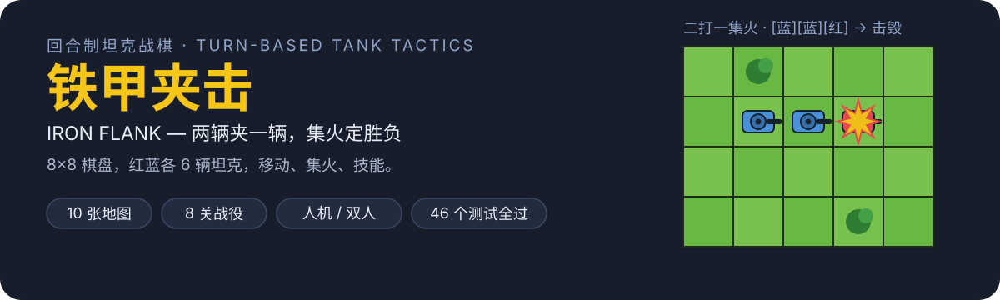
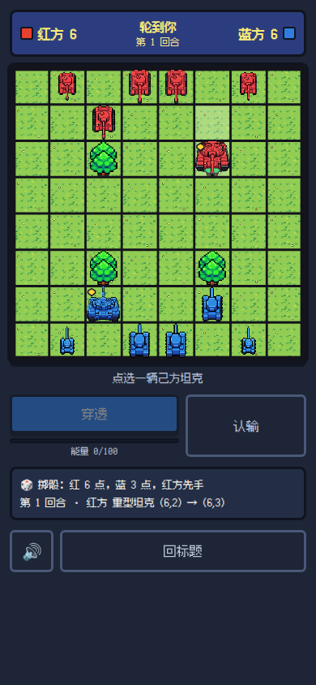
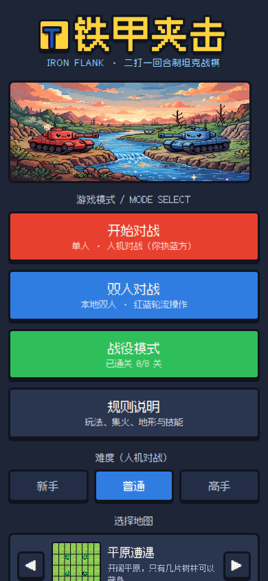

<p align="right"><a href="README.en.md">English</a></p>

<p align="center">
  
</p>

<p align="center">
  <a href="https://holynova.github.io/iron-flank/">▶ 在线玩</a>
  ·
  <a href="https://github.com/holynova/iron-flank">GitHub 仓库</a>
</p>

铁甲夹击是一款二打一回合制坦克战棋：在 8×8 棋盘上，红蓝双方各 6 辆坦克轮流移动；当两辆己方坦克与一辆敌方坦克连成一线，敌方即被集火击毁。先把对方消灭到只剩 1 辆者获胜。移动端优先，竖屏可玩，零构建，纯 JS + Canvas。

## 截图

<p align="center">
  
  
</p>

## 玩法

- **移动**：每回合移动一辆坦克，正交方向走 1 格；轻型坦克可走 2 格（第二步可停）。山地、河流不可进入。
- **二打一集火**：坦克落点后，扫描所在行与列。连续三格出现 `[我][我][敌]` 或 `[敌][我][我]`，最外侧的敌军即被击毁。行列独立结算，一次移动最多击毁两辆。
  - **友军保护**：目标紧邻同色友军时，集火无效。
  - **拥挤豁免**：某条线上超过 4 辆坦克时，整条线不结算。
  - **地形免疫**：森林、城市上的坦克免于集火。
  - **重型坦克**：第一次被集火只掉装甲，第二次才被击毁。
- **指挥官技能**：每次击毁 +50 能量，满 100 可释放，持续到自己下个回合开始。
  - 红方「铁壁」：己方全军免疫集火。
  - 蓝方「穿透」：己方集火无视友军保护。
- **胜负**：敌方剩 ≤1 辆获胜；100 回合未分胜负按剩余坦克与击杀数判定；双方都无路可走时平局。开局掷骰定先手。

## 模式与内容

- **人机对战**：三档难度（新手 / 普通 / 高手），启发式 AI；你执蓝方。
- **本地双人**：同一设备轮流操作。
- **战役模式**：8 关，难度递进（简单 ×2、普通 ×3、困难 ×3），胜则解锁下一关。
- **10 张地图**：平原遭遇、森林夹击、断河防线、群山隘口、双城对峙、混合战场、纵贯河道、城市巷战、双峰夹道、森林伏击。
- **3 兵种**（轻型 2 步 / 中型 / 重型 2 血）、**5 地形**（平原 / 森林 / 山地 / 河流 / 城市）、战报复盘、结算统计。

## 本地运行

零构建，直接打开 `index.html` 即可玩；或起一个静态服务器：

```bash
python3 -m http.server 8000
# 打开 http://localhost:8000
```

规则测试（46 个用例，Node 直接跑）：

```bash
node tests/test-core.js
```

## 技术

- 纯 JS + Canvas，零构建、零依赖；移动端优先，竖屏 390px 可玩。
- 规则核心是纯函数（`js/core.js`），可在 Node 跑测试与模拟；数据驱动（`js/data.js`）；单步启发式 AI（`js/ai.js`，非 Minimax）。
- 架构与像素美术基于 CocoSgt《潮汐战线》（MIT，见 `LICENSE-TIDEMARK.md`）；字体为 Fusion Pixel（SIL OFL 1.1）。

```
index.html          入口（菜单 / 战役选关 / 对战 / 结算 / 复盘）
css/style.css       卡通像素风，移动端优先
js/data.js          数据表：兵种 / 地形 / 技能 / 地图 / 战役 / 界面文字
js/core.js          规则核心：掷骰 / 移动 / 集火 / 技能 / 胜负
js/ai.js            启发式 AI：单步模拟 + 打分，三档参数集
js/sprites.js       美术素材加载（AI 生成像素图片 assets/*.png）
js/render.js        Canvas 渲染：亮绿草地、粗黑网格、主菜单日落横幅
js/ui.js            界面控制器
tests/              Node 测试与 AI 对局 soak
```

## 许可

MIT，见 `LICENSE`。
